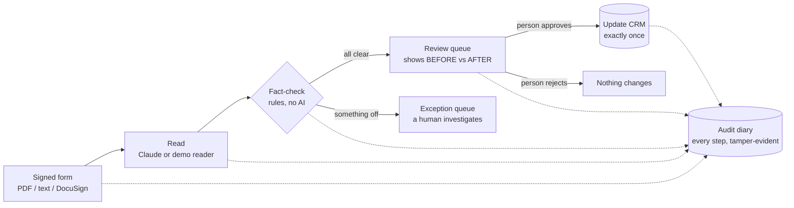

# Org Automation Scaffold

**In one sentence:** a safe "document robot" — it reads a client form, fact-checks what it read, asks a
human to approve, and only then updates the client record, writing every step to a tamper-evident diary.

> Everything here uses **synthetic data and mock integrations**. It does not connect to real Org
> systems, and by default it doesn't use any AI. It is a working blueprint, **not** production software.

## Quick start

| What | Command / location |
|---|---|
| **Live 5-minute demo** (happy path + exception + audit verify) | `python scripts/demo_walkthrough.py` |
| **Demo web screen** (after `uvicorn`) | http://127.0.0.1:8000/ — see [The demo screen](#the-demo-screen) |
| **Interactive API docs** (after `uvicorn`) | http://127.0.0.1:8000/docs |
| **Run the full test suite** | `pytest -q` |

The demo uses only synthetic data and the built-in mock CRM. A fresh local checkout has development-only demo keys by default, so the sign-in buttons work even before you create `.env`. Copy `.env.example` to `.env` to customize settings. Production startup is refused while demo keys remain configured.

## The idea in plain English

Think of a very careful intern with three rules:

1. **Read, but never trust yourself.** Pull the facts off the form, quote the exact sentence you got each one from.
2. **Get checked.** A separate, boring rule-checker (no AI) verifies each fact: is it really in the document?
   is the date sane? does this client exist? was the reader confident enough?
3. **Never change anything without a person's OK** — and write down who said OK, and when.



## How this maps to the defined goals

| The goal asks for… | Where it shows up |
|---|---|
| Use Claude for document extraction, structured outputs, prompt engineering | `ai/client.py` — Claude is forced to answer through a fixed JSON form (tool use); document text is fenced off as untrusted data |
| Strong verification, human-in-the-loop | `validation/rules.py` (grounding + confidence checks), `approvals/`, `workflows/review_decision.py` |
| Full auditability | `audit/writer.py` — hash-chained log, `GET /audit/verify` proves nothing was edited |
| RAG with sound judgment about verification | `knowledge/` + `documents/chunking.py` — parent-child ("small-to-big") policy search with citations, access control, and a retrieval report card |
| AI that calls tools, safely | `agent/` — an eleven-tool menu behind a security gateway (see next section) |
| Integrations: CRM, Microsoft 365/Graph, DocuSign, custodians; REST, webhooks, OAuth | `integrations/` — adapter "plug shapes"; **Salesforce adapter** (OAuth client-credentials, REST/SOQL, least-privilege fields, stale-data protection); mock CRM and mock DocuSign; DocuSign webhook signature check is real; Graph and the real DocuSign fetch are stubs |
| Power Automate / workflow tools | Plain HTTP endpoints with API-key auth — a Power Automate "HTTP" action can call them directly |
| Processing PDFs | `documents/pdf.py`, `POST /documents/{id}/process-pdf` (page numbers tracked) |
| Security & data-governance mindset | Redaction before AI/logs, least-privilege roles, secrets never in code, startup refuses demo keys in production |
| SQL / data fundamentals | `storage/database.py` schema + `sql/reporting_queries.sql` (volumes, turnaround, top error causes, stuck work) |
| Set standards for AI + automation at the firm | `scripts/evaluate_extraction.py` + `data/synthetic_eval.jsonl` — measure accuracy *before* trusting any AI |

## Model settings and semantic retrieval

The development UI includes **System flow** and **Model settings** screens. System flow visualizes the DocuSign webhook, validation, approval gate, Salesforce read/write, audit events, and the intended SharePoint archive step. The diagram explicitly labels SharePoint / Microsoft Graph as a stub: the project does not yet upload documents to a real SharePoint site.

### Configure and test generation + embedding models

1. Start the app and sign in with a demo account.
2. Open **Model settings**.
3. Under **Generation model**, choose Anthropic Claude or OpenAI-compatible / local Ollama. The generation model must be a chat/instruct model (for example `llama3.1`), not an embedding-only model.
4. Under **Embedding model**, separately choose Ollama embeddings and `nomic-embed-text` for semantic policy search.
5. Click **Apply settings**, then **Test generation model** and **Test embedding model**. The tests make real requests to the configured services and report success or a safe diagnostic.
6. Click **Re-embed indexed policy chunks** to generate vectors for the policy documents already in the SQLite library. New policy documents indexed by the running server use the active embedding configuration.

For local Ollama, install/start Ollama and run:

```bash
ollama pull llama3.1
ollama pull nomic-embed-text
```

Use `http://localhost:11434/v1` as the generation API base URL and `http://localhost:11434` as the embedding API base URL. If the app itself runs inside Docker, `localhost` refers to the container; try `http://host.docker.internal:11434` instead. The local model must support tool/function calling for structured document extraction and the agent workflow.

The UI settings are **in-memory for the running process**; they are not persisted to `.env`, and entered credentials are not written to disk or returned to the UI. Restarting restores `.env` defaults. The development settings and test endpoints are disabled outside `ENVIRONMENT=development`.

**Important workflow distinction:** the generation model is used when **Process document** extracts fields from a client PDF and when the model-driven agent selects tools. The embedding model is used by **Policy search** to compare questions with indexed policy chunks using vector similarity. Embeddings are not required for PDF field extraction. Policy search falls back to SQLite FTS5/BM25 when embeddings are disabled or vectors have not been created for the selected model. Switching embedding models requires re-embedding the policy chunks so vectors from different models are never compared.

The current implementation keeps parent-child chunking: it embeds each child chunk with its document title and parent section, ranks child vectors across the authorized indexed corpus, applies the audience filter inside the database query, and returns the full parent section with a citation. **Document search now includes retrieval-augmented generation (RAG):** the selected generation LLM answers from the retrieved passages and cites them as `[1]`, `[2]`, etc.; source passages are displayed below the answer so a human can verify them. If the answer model is unavailable, the UI still attempts to show the retrieved passages. If the embedding endpoint is unavailable, retrieval falls back to SQLite BM25 and labels those results as keyword matches. The configured Ollama embedding endpoint is intended to be local; indexed policy text is not sent to a hosted embedding vendor.

### Add a PDF to the searchable library

Sign in as a reviewer (`alice` or `bob` in the local demo), open **Document search**, and use **Add a document to the searchable library**. Give the document a stable ID, title, access audience, and a text-based PDF. The server extracts its text, redacts obvious SSN/long-number patterns, chunks it into parent sections and child passages, and generates embeddings when Ollama embeddings are enabled. Scanned PDFs need OCR, which is not included. This library-upload action is intentionally separate from **Process document**: client-change forms enter the human-approval workflow and are not automatically published to the shared search library. Do not put client-specific records in the policy library.

The search and answer APIs are `GET /knowledge/search?q=...` (retrieval only) and `GET /knowledge/answer?q=...` (RAG answer plus cited source passages). Both apply role-based audience filters and log the source chunk IDs shown to the caller. **Live Salesforce and SharePoint querying is not part of this search yet**; those connectors need their own OAuth and per-record/document permission enforcement before they can safely be included in a common search.

## Salesforce

`CRM_PROVIDER=salesforce` swaps the pretend CRM for a real **Salesforce** adapter (`integrations/salesforce.py`); nothing else changes.
- **Logs in with OAuth client-credentials**, keeps the token in memory only, refreshes it once if it expires, and only ever talks to HTTPS hosts on `salesforce.com` / `force.com`.
- **Finds clients by the firm's client number** (a custom External-ID field), asking Salesforce for only the two fields it needs. Zero matches = unknown client; two or more = flagged "ambiguous", never guessed.
- **Writes only email and effective date.** Before writing it re-reads the record: already updated means no-op (safe retries); changed since the reviewer looked means **refuse** (`CrmConflict`), audit it, and send it back for re-review instead of overwriting a colleague's edit.
- **Safe failures:** outages become retryable 502s; errors carry a status and Salesforce error *code* only, never tokens, URLs or client data. `GET /health/crm` (reviewer) checks connectivity.
- Setup, field mapping (including Person Accounts / Financial Services Cloud) and least-privilege permissions: [`docs/SALESFORCE_SETUP.md`](docs/SALESFORCE_SETUP.md). Verify read-only in a sandbox with `python scripts/salesforce_smoke_test.py <client number>`.
- **Honest status:** tested against a simulated Salesforce org (16 tests), **not a live org**. Use a sandbox, and have your Salesforce admin confirm object/field names and the current OAuth setup screens. Whether Org actually uses Salesforce isn't stated in the job posting; the field mapping is configurable either way.

## Write mode: shadow first, writes when you decide

One setting, `WRITE_MODE`, controls whether approved changes are really written to the CRM. The write code is all still there; the
switch is enforced at a single checkpoint (`WriteGate` in `integrations/crm.py`) that every CRM handed out by `get_crm()` sits behind, so no
caller can forget it.

| `WRITE_MODE` | What happens on approval |
|---|---|
| `shadow` | Everything runs except the write: the record is read, the stale-data check runs, and the audit log gets a `crm_update_shadowed` entry saying what **would** have been written (field names only, no client values). The CRM is never touched. |
| `enabled` | Writes go through to the CRM as designed. |
| *(unset)* | The pretend (mock) CRM writes, since it is harmless. **Any real CRM stays in shadow.** Real writes have to be asked for. |
| a typo such as `enable` | The app refuses to start, rather than guessing. |

The screen shows a banner while in shadow mode, and `GET /health/crm` reports the mode. Suggested rollout: shadow against real accounts with a
read-only Salesforce permission set (so even a bug in the gate could not write), review the "would have written" entries against what staff
actually did, then set `WRITE_MODE=enabled` and restart.

## The scorecard

`GET /scorecard?days=30` (reviewers; also the **Scorecard** tab) answers "is this automation any good?" from the system's own records:
volume, exceptions and why, review decisions and how long they took, and how many agent requests the gateway refused.

The part that matters for a trial is the **agreement check**. For every proposed change it reads the client's CRM record *now* and compares it
with what was proposed and with what the record held at the time:

| Outcome | Meaning |
|---|---|
| agreed | staff made exactly the proposed change, so the system was right |
| untouched | nobody has made the change yet (the backlog the automation would clear) |
| different | staff changed a field to something else; look at these first |
| partial | staff made some of the change |
| applied_by_system | set aside, because changes the system wrote itself obviously match |

So a read-only trial in `WRITE_MODE=shadow` produces a real answer in week 1: how often staff and the system independently reach the same
result, and exactly where they differ. The time-saved estimate appears only if you set `MANUAL_MINUTES_PER_UPDATE` from your own timings; it is never guessed.
In development with the pretend CRM there is a **Demo helper** on the tab that stands in for a colleague editing Salesforce.

## The demo screen

A plain web page for showing the whole flow to a non-technical audience. Start the app (`uvicorn org_automation.main:app --reload`),
run `python scripts/index_policies.py` once, and open **http://127.0.0.1:8000/**. No build step, no outside libraries.

| Sign in as | Sees | Good for showing |
|---|---|---|
| `flow` (automation account) | Submit a document · Run the agent · Document search | The clean path, an unknown client, a duplicate request, and the agent screen: each run is labelled **Driver: scripted** or **Driver: LLM (provider · model)**, with every tool request shown next to the gateway's decision (allowed or refused and why), plus anything Claude said in words. **Webhook demo** (development only): the server plays DocuSign, signs a "document changed" message and hands it to the real webhook receiver; you can send it twice (duplicate ignored) or forged (rejected 401), and see the agent run it triggers. In development there are also two separate attack-test actions: **Test env-1004 with the real configured LLM** (forces the configured provider/model even if `AGENT_MODE=scripted`) and **Replay the simulated attack** (no AI; `agent/simulation.py`). Both go through the real gateway. The real-model run shows actual tool calls; text that merely says “I will call a tool” is not counted as a call. During execution, the model must issue one tool call per turn; accompanying narration is discarded. A text-only answer triggers up to two explicit retry prompts and, if the model still makes no tool call, the run is marked incomplete. Plain-English output is requested separately after a successful workflow-status call and cannot trigger actions or change the recorded outcome. |
| `alice` or `bob` (reviewer) | Review queue · Document search · Audit log | Before/after comparison, the four-eyes rule, "approve needs a note", and **Verify audit log** |

Demo order: submit as `flow` → sign out → approve as `alice` → open the audit log → verify.

How it stays safe:
- It uses the same API and the same keys as any other caller, so it can't do anything the API would refuse.
- Text that came from a document or from the AI is only ever inserted as plain text (no `innerHTML`; a test enforces this), and the page is served with a strict Content-Security-Policy.
- The one-click demo sign-in buttons exist only when `ENVIRONMENT=development` **and** only for keys that start with `demo-`. Fresh installs use `flow` (`demo-service-key`), `alice` (`demo-alice-key`), and `bob` (`demo-bob-key`) for local demonstration. In production use Microsoft Entra ID sign-in (`AUTH_MODE=entra`, see [Sign-in with Microsoft Entra ID](#sign-in-with-microsoft-entra-id)); startup refuses to run if demo keys remain configured.
- The key lives in the browser tab's session storage and disappears when the tab closes.

Files: `src/org_automation/ui/` (`index.html`, `app.js`, `styles.css`). New small endpoints it uses: `GET /me`, `GET /audit/events`, `GET /approvals?status=…`, `GET /ui/config`.

## The AI tool layer

The AI can now *act*, but only by asking a **gateway** to run one of eleven tools. The gateway, not the AI, decides.

| Tool | Purpose | Who can trigger it | Enforced by |
|---|---|---|---|
| `get_document_status` | Is signing completed? | AI, within this run's document scope | scope check |
| `retrieve_document` | Fetch the signed document | AI, but **controlled**: only if signing is complete; AI gets a redacted preview, full text stays on the server | live status re-check, redaction |
| `extract_document_fields` | Typed fields + page + quoted evidence | AI | must retrieve first |
| `validate_extracted_fields` | Deterministic checks | AI *requests*; **code** runs the checks on server-held data | AI can't pass values in |
| `get_client_record` | Approved CRM fields | AI, **permission-checked**: only the client named in this document; only `email` and `effective_date` | client allow-list + field allow-list |
| `compare_client_data` | Find mismatches | AI; plain equality, no AI judgement | must validate first |
| `submit_for_review` | Send to an approver | AI, under policy: validate (and compare) first, once per run; proposal built from server state | policy + server-built proposal |
| `apply_approved_update` | Commit a CRM update | **Not on the AI's menu** unless the run is a "resume" for one specific, already-approved item; then still needs a human approver who is not the submitter | `workflows/apply_update.py` (single write gate) |
| `get_workflow_status` | Completed or failed? | AI | scope check |
| `search_policy_documents` | Look up firm procedure, with citations | AI, **controlled**: sees only policy documents its run is cleared for; passages arrive labelled untrusted; what it was shown is logged | audience filter inside the search query |
| `write_audit_event` | Record a security event | **App only.** Invisible to the AI; the gateway logs *every* tool call automatically, including refused ones | gateway |

Design rules:
- **The AI never carries data between steps.** It passes a document ID; the server holds the text, the extraction, and the CRM data. A hijacked AI cannot swap in doctored values before validation.
- **Hidden tools look nonexistent.** Asking for `write_audit_event` gets the same reply as asking for a made-up tool, and the attempt is logged.
- **Hard limits:** a per-run call budget, a turn limit, strict argument forms (extra fields rejected), size-capped redacted results.
- **Same safety with or without AI:** `AGENT_MODE=scripted` runs the tools in a fixed order (no AI); `AGENT_MODE=llm` lets the configured provider/model choose (Claude or an OpenAI-compatible/local model). `AGENT_MODE=claude` remains a legacy alias for `llm`. Both go through the same gateway.
- **Four-eyes:** whoever submits an item can never decide it, an AI agent can never be the approver, and an approval must carry a note (enforced by the server, not just the browser).
- **Tested against attack:** `tests/test_agent.py` includes a pretend hijacked Claude that tries to apply updates, forge audit entries, look up another client, and loop forever. Each attempt is blocked and logged, and the legitimate work still completes. The mock envelope `env-1004` contains a real injected instruction.

```bash
# let the agent process a signed (mock) DocuSign envelope: env-1001 clean, 1002 unknown client, 1003 unsigned, 1004 injection
curl -X POST localhost:8000/agent/runs/env-1001 -H 'Content-Type: application/json' \
  -H 'X-API-Key: demo-service-key' -d '{"event_id":"run-001"}'
curl localhost:8000/documents/env-1001/workflow-status -H 'X-API-Key: demo-alice-key'
```
Then approve it with the `/approvals/.../decision` call from the demo below. If the CRM was down when someone approved, post to
`/agent/runs/<doc>` with `{"event_id": "<new id>", "approval_id": "<id>"}` to retry the write; it is idempotent and applies at most once.

## The policy library: RAG, done conservatively

Staff and the agent can search a library of internal policies. The design choices, in order of importance:

- **Parent-child ("small-to-big") chunking.** Policies are cut into sections (parents) and short paragraph groups (children). Search matches the precise child, then returns the whole parent section for context, once per section, with a citation (document, section, IDs) a human can check.
- **Hybrid retrieval.** When configured and indexed, local embeddings provide semantic similarity search across the authorized corpus; SQLite FTS5/BM25 remains the offline and outage fallback. Result cards identify which retrieval method produced each match. `scripts/evaluate_retrieval.py` remains the baseline report card.
- **Access control inside the query.** Each document has an audience (`all_staff`, `advisors`, `compliance`). Restricted documents are never search candidates for callers who aren't cleared, and the AI cannot choose its own audience.
- **Safe to re-run.** Chunk IDs come from document ID + position (no random IDs), so re-indexing replaces rather than duplicates, and unchanged files are skipped. Replacement is one all-or-nothing database step.
- **Governance.** Sensitive numbers are blacked out before indexing; deleting a document removes every piece and its search entries; every index, delete, and AI search is audited (including exactly which passages the AI was shown).
- **Untrusted by default.** Retrieved text is labelled untrusted for the AI and goes through the same gateway as every other tool. In the demo, when a document would change a client's email, the scripted agent searches for the governing policy and cites it in its note to the reviewer.

```bash
python scripts/index_policies.py              # load the 4 synthetic sample policies (re-runnable)
python scripts/evaluate_retrieval.py          # the report card
curl 'localhost:8000/knowledge/search?q=how+long+do+we+keep+signed+documents' -H 'X-API-Key: demo-service-key'
```
Measured on 10 practice questions: **hit@1 7/9, hit@3 9/9, leaks 0** (the 10th case checks that a restricted policy stays hidden from staff, and it does).
Those keyword-only baseline misses remain useful when comparing BM25 against configured semantic embeddings. All policy text is synthetic and invented; it is not Org's.

## Does it actually work? (measured, not claimed)

```bash
python scripts/evaluate_extraction.py        # baseline: simple pattern-matching reader
python scripts/evaluate_extraction.py --mode claude   # same test, real Claude (needs a key)
```

Baseline result on the 10 synthetic documents: **8/10 fully correct, all 10 routed to the right queue, 1 "bad pass"** —
a document listing an *old* and a *new* email, where the pattern-matcher grabbed the old one and the checks couldn't tell.
That single case is the argument for an LLM reader *and* for measuring it: the goal metric is **bad passes = 0**.
The Claude-mode run has not been executed here (no API key in the build environment) — run it before presenting and put the real numbers on a slide.

## Run it

```bash
python -m venv .venv
source .venv/bin/activate
pip install -e ".[dev,claude]"
cp .env.example .env
python scripts/index_policies.py
pytest -q
uvicorn org_automation.main:app --reload
```
(Windows: activate with `.venv\Scripts\activate`. `dev,claude` installs the test tools and the Claude library; use `.[dev]` if you will never use real-AI mode.)
If any issues with module:
```
python -m uvicorn org_automation.main:app --reload
```
Open http://127.0.0.1:8000/docs for the interactive page. Demo (keys come from `.env.example`):

```bash
# 1. a robot (Power Automate, say) submits a document
curl -X POST localhost:8000/documents/demo-001/process \
  -H 'Content-Type: application/json' -H 'X-API-Key: demo-service-key' \
  -d '{"document_type":"client_update","event_id":"evt-001","text":"Client ID: C10482\nEffective date: 2026-10-12\nEmail: client@example.com"}'

# 2. a human sees the queue (note the BEFORE/AFTER values), then approves
curl localhost:8000/approvals -H 'X-API-Key: demo-alice-key'
curl -X POST localhost:8000/approvals/<approval_id>/decision \
  -H 'Content-Type: application/json' -H 'X-API-Key: demo-alice-key' \
  -d '{"decision":"approve","note":"matches signed form"}'

# 3. prove the diary is intact
curl localhost:8000/audit/verify -H 'X-API-Key: demo-alice-key'
```
Resend step 1 with the same `event_id` and it is ignored (no double-processing). Try a wrong client ID like `C99999` and it lands in the exception queue instead of vanishing.

## Using real Claude

Set `EXTRACTION_MODE=claude` and `ANTHROPIC_API_KEY` in `.env`, and `pip install -e ".[claude]"`. Before sending data to any
LLM at a real firm, confirm the vendor agreement, data-retention terms, and Org's approved-AI policy. The unit tests
check request shape and response parsing with a pretend Claude; a live call is untested here.

## What each folder does

| Path | Job, in plain English |
|---|---|
| `api/routes.py` | The front door: every web address the app answers, and who may use it |
| `api/ui.py`, `ui/` | The demo web screen and the small settings page it reads |
| `agent/` | The AI tool layer: `tools.py` (the 11 tools), `gateway.py` (the security checkpoint), `runner.py` (scripted or Claude driver), `context.py` (server-side case file) |
| `workflows/` | The assembly line (`process_document`), the approve/reject step (`review_decision`), the single CRM write gate (`apply_update`), and policy indexing (`index_policy`) |
| `ai/` | Reading documents: `client.py` talks to Claude, `extraction.py` holds the Claude and demo readers |
| `validation/rules.py` | The fact-checker that doesn't trust the reader |
| `approvals/service.py` | The human review queue and its safety rules |
| `audit/writer.py` | The tamper-evident diary |
| `integrations/` | Connectors: CRM (`crm.py` plug shape + mock, `salesforce.py` real), DocuSign (mock + real webhook check), Microsoft 365 and OAuth stubs |
| `documents/` | Data shapes (`schemas.py`), PDF reading (`pdf.py`), and the parent/child slicer (`chunking.py`) |
| `core/` | Settings, login (`auth.py`), duplicate protection (`idempotency.py`), sensitive-number redaction |
| `storage/database.py` | The filing cabinet (SQLite) |
| `knowledge/` | The policy library: `store.py` (shelves), `search.py` (small-to-big search + access control), `loader.py` (reads policy files) |
| `scripts/`, `data/` | Report cards for extraction and policy search, their answer keys, and 4 synthetic sample policies in `data/policies/` |
| `sql/` | Ready-made operations reports |
| `tests/` | 208 automated checks, including `test_regressions_v10.py` (one test per bug fixed in the v10 review) `test_graph.py` (the Microsoft Graph connector, against simulated servers) and `test_entra.py` (Entra ID sign-in, with locally signed tokens; plus `scripts/ui_smoke_test.mjs`, a headless check of the sign-in screen, run with node + jsdom): simulated attacks on the agent, access control for the policy library, and a simulated Salesforce org (`fake_salesforce.py`) |

Every source file also opens with a **PLAIN ENGLISH** note explaining its job.

## What the injection test does and does not show

`env-1004` contains a hidden instruction aimed at an AI. With `AGENT_MODE=scripted` the checklist never reads the text, so a clean run proves nothing about resistance. The simulated agent shows the gateway refusing a *hijacked* agent. The development-only **real configured LLM** action tests whether the selected model follows the injection, regardless of `AGENT_MODE`; measure that before claiming it. The current run outcome is displayed separately from the historical document workflow state, so an old CRM update cannot be mistaken for an action performed by this run.

## Sign-in with Microsoft Entra ID

**What it does.** People sign in with their work account on Microsoft's own page; the browser gets a signed access token and
sends it as `Authorization: Bearer ...`. The API verifies it locally (`core/entra.py`): RS256 signature against your tenant's
published keys, v2.0 issuer and tenant, audience = this API, expiry, then **who and what**:

| Caller | Token has | Becomes | Can never be |
|---|---|---|---|
| A person | delegated scope `access_as_user` and app role **Reviewer** (or a mapped directory group) | `reviewer`, named by their sign-in name | automation |
| Automation (Power Automate, a service) | app-only token with app role **Service** | `service`, named `app:<client id>` | a reviewer |

No role means no access. Rejected tokens only ever get "Invalid or expired token" (the reason goes to the server log). If
Microsoft's signing keys cannot be fetched and none are cached, callers get a 503, not a false 401.

**`AUTH_MODE`**: `api_key` (default, unchanged), `entra` (Bearer tokens only; API keys refused, demo logins gone), or
`hybrid` (both, for migration; a bad Bearer token never falls back to a good API key). Production with `entra` needs no API keys.

**Setup in Entra ID (about 15 minutes)**
1. **API app registration** (this API): Expose an API, add scope `access_as_user`; in the manifest set
   `requestedAccessTokenVersion` to `2`. Define **App roles**: `Reviewer` (allowed member types: Users/Groups) and `Service`
   (allowed member types: Applications). Note its client id → `ENTRA_API_CLIENT_ID`; your tenant id → `ENTRA_TENANT_ID`.
2. **Assign roles**: Enterprise applications → this API → Users and groups → assign `Reviewer` to your reviewers' group.
   For automation, give its app registration the `Service` application permission and grant admin consent.
   (Optional instead of app roles for people: set `ENTRA_GROUP_ROLES=<group-object-id>:reviewer` and add the groups claim.
   Prefer app roles: group lists over 200 are truncated by Microsoft and grant nothing here.)
3. **Browser app registration** (the page): platform **Single-page application**, redirect URI `https://<your-host>/ui/`
   (exactly; `http://localhost:8000/ui/` for local tests), then API permissions → add `access_as_user` for the API → grant
   consent. Its client id → `ENTRA_SPA_CLIENT_ID`.
4. `.env`: `AUTH_MODE=entra` (or `hybrid` while migrating), plus the three ids above. Restart; startup checks them.

The page loads Microsoft's MSAL.js (vendored in `ui/`, see `ui/VENDORED.md`) only when Entra is on, and the page's security
policy then also allows calls to `login.microsoftonline.com`. Tokens stay in `sessionStorage` (gone when the tab closes).

**Not verified / decide.** No live tenant here: the checks use locally generated keys and a simulated browser, so do a first
sign-in test with a real account before relying on it. Conditional Access, MFA and session lifetime are your tenant's
policies, not this app's. Not built: step-up or per-document permissions, and separate directory groups for policy audiences.

## Microsoft Graph integration (SharePoint archive)

**What it does.** After a person approves a client change and the CRM step finishes (or is shadowed), the app files an
*approval record* (proposed changes, CRM values before, who submitted, who approved, their note, result) as a small JSON
file in one SharePoint folder. Compliance gets an evidence copy outside this app's database.

**Safety rules (same spirit as the CRM step)**
- Only `apply_update.py` triggers it, only after a human approval. The AI agent has no tool for it (a test enforces this).
- A real archive follows the write gate: with `ARCHIVE_PROVIDER=sharepoint` it files nothing unless `WRITE_MODE=enabled`
  is set explicitly; otherwise the audit log records `archive_shadowed` ("would have filed").
- Retries are safe: the file name comes from the approval id and uploads use `conflictBehavior=fail`; "already exists" is
  confirmed and reported as `already_filed`, never duplicated or overwritten.
- A filing problem **never** undoes an approval or the CRM change. It is audited as `archive_failed` (error type only) and
  the approve call still returns 200 with `crm_update.archive.status = "failed"`.
- Tokens stay in memory, go only to `graph.microsoft.com` (https, no redirects, host-checked), and never appear in logs,
  errors or audit rows. Records are redacted before upload; the audit log stores only the opaque SharePoint item id.

**Setup (real tenant)**
1. Entra ID: register an app; add **Microsoft Graph application permission `Sites.Selected`** and grant admin consent.
2. Grant that app write access to **one** site only (Graph `POST /sites/{id}/permissions`, role `write`), not the tenant.
3. Set in `.env`: `GRAPH_TENANT_ID`, `GRAPH_CLIENT_ID`, `GRAPH_CLIENT_SECRET`, `GRAPH_SITE_ID`, optional `GRAPH_FOLDER`
   (default `Client Updates`), then `ARCHIVE_PROVIDER=sharepoint` and, when ready to file for real, `WRITE_MODE=enabled`.
4. Check `GET /health/archive` (reviewer). Try the demo first with `ARCHIVE_PROVIDER=mock` (records go to a local table).

**Not done / needs your decision.** Verified against *simulated* Graph responses only, never a live tenant. Not yet
built: reading source documents from SharePoint (would be a second adapter behind the
`ctx.docusign` seam), and a retry endpoint for `archive_failed`. Prefer a certificate or managed identity to a client secret.

## Honest limits — before anything like this touches real client data

- Salesforce is tested only against a simulation; Graph, general OAuth, and DocuSign document fetch are stubs (the SharePoint archive via Microsoft Graph is built and tested against simulated responses; see [Microsoft Graph integration](#microsoft-graph-integration-sharepoint-archive)). Custodian integrations don't exist yet. Real vendor choices change the adapters, not the design.
- `AUTH_MODE=api_key` (the default) is demo-grade shared keys. `AUTH_MODE=entra` gives real per-person sign-in, but it has been tested only with locally generated tokens and a simulated browser, never against a live tenant. Policy-library audiences are still derived from the two roles, not from separate directory groups. (The four-eyes rule, submitter ≠ approver, is enforced both in the app and by the identity types: people can only be reviewers, automation only service.)
- The Claude-driven agent loop is tested with a pretend Claude only; a live run needs your key, and its behaviour (how often it follows the intended order, how it handles denials) should be measured before you rely on it. The scripted driver is the safe default.
- The mock DocuSign has four envelopes. A signed `envelope-completed` webhook now starts an agent run (other events are only logged); the agent re-checks signing status itself rather than trusting the message.
- SQLite and in-request processing; production needs a managed DB, a durable queue with retries (an "outbox" for the CRM write), and monitoring/alerting.
- The audit log is tamper-*evident*; also ship it to write-once storage. No retention policy is implemented.
- The DocuSign webhook receiver verifies the signature, dedupes and starts the agent, but the real DocuSign fetch of the signed PDF is still a stub; confirm header/scheme details against DocuSign's current docs.
- Scanned (image-only) PDFs are rejected clearly — OCR isn't included.
- Policy sections are found from markdown headings; detecting sections inside messy or scanned PDFs is not attempted. Keyword search misses paraphrases (measured above). Audience labels are set per document by whoever indexes it; production should derive access from the firm's directory groups and per-client permissions, and consider retrieval for client documents (a much higher bar than internal policies).
- Redaction is regex-based and a safety net only. Needs security testing and compliance review. Not production-ready financial-services software.

## Real-LLM workflow reliability

The real-LLM agent now receives a state-aware tool menu: it is offered the next legitimate workflow action instead of the entire tool catalogue at every turn. This is guidance for the model, not a security boundary; every request still passes through the gateway and server-side validation. The turn budget was increased to allow recovery from local-model text-only turns.

Some OpenAI-compatible local models incorrectly call `get_client_record` with `document_id` instead of its required `client_id`. In that specific missing-argument case, the runner resolves the client ID from the server-held extraction for the authorized document. It never rewrites an explicitly supplied `client_id`, so attempts to access a different client remain subject to the existing scope check. The run transcript records the resolved argument actually sent to the gateway, and the model notes explain the correction.

The current run outcome remains separate from the historical document workflow state. A historical `crm_update_applied` event is not evidence that the current run changed the CRM.
